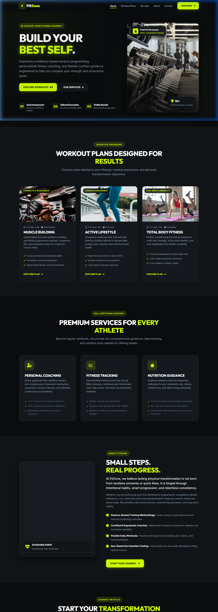
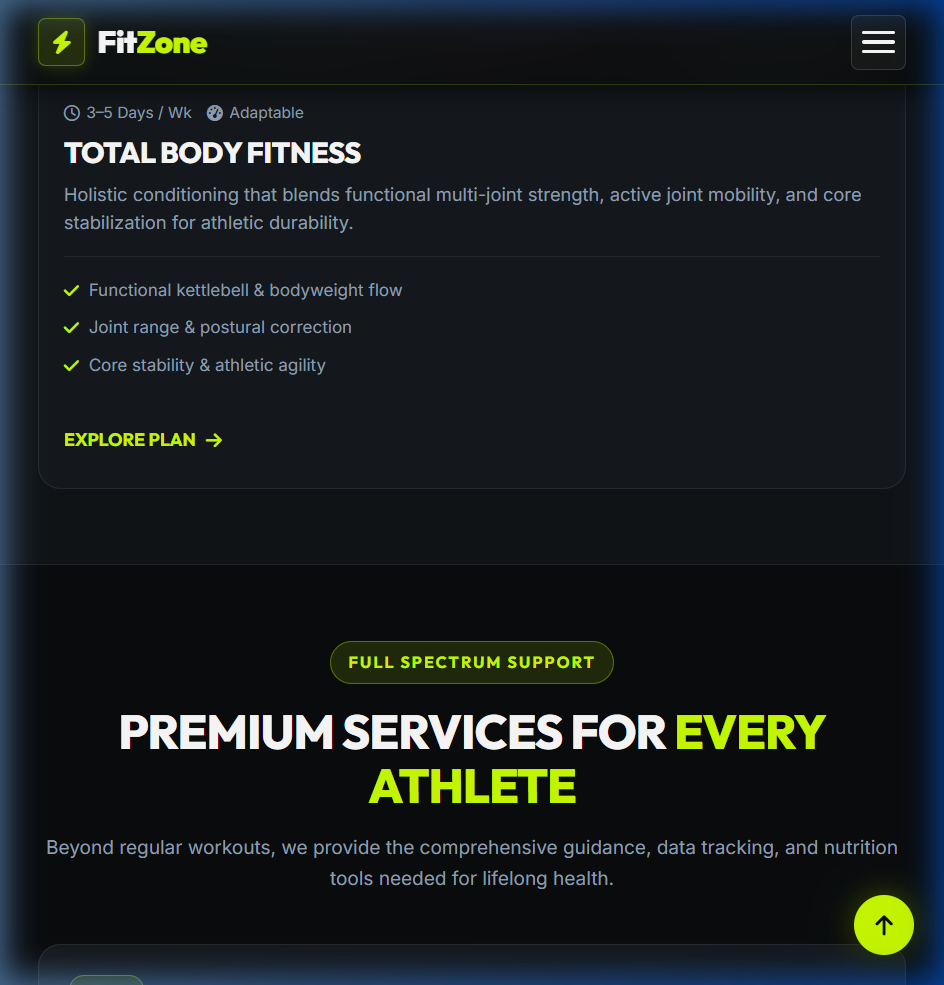
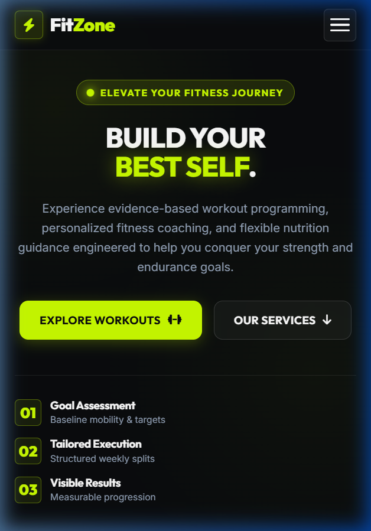
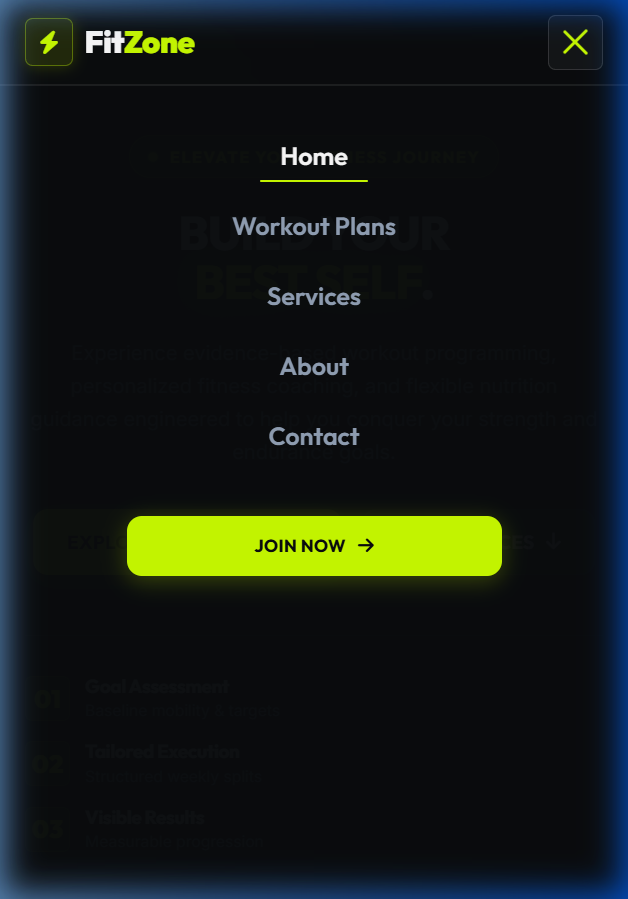
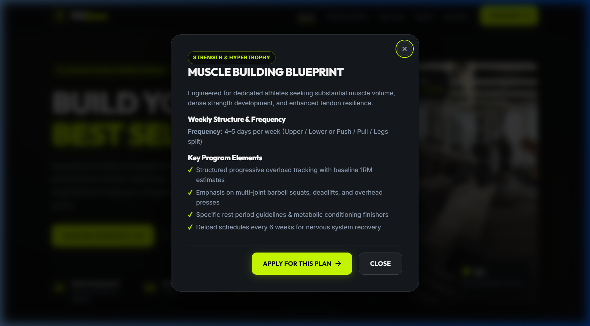

# FitZone — Build Your Best Self

> A modern, premium, fully responsive fitness service website engineered with semantic HTML5, pure CSS3 (Flexbox & CSS Grid), and accessible Vanilla JavaScript.


---

## 📌 Project Overview

**FitZone — Build Your Best Self** is a front-end fitness web application designed to demonstrate state-of-the-art responsive design principles, modern CSS layout architectures (CSS Grid & Flexbox), accessible UI/UX patterns, and lightweight interactive client-side logic without any third-party framework dependencies.

The interface presents a high-energy athletic aesthetic combining deep charcoal/black surfaces (`#0a0c0e`, `#111417`, `#171b1f`) with a high-contrast neon lime-green accent (`#ccff00`).

---

## 🚀 Key Features

- **Semantic HTML5 Architecture:**
  - Distinct landmark regions (`<header>`, `<nav>`, `<main>`, `<section>`, `<article>`, `<footer>`).
  - Screen reader accessible keyboard skip link (`.skip-link`).
  - Standardized heading hierarchy (`<h1>` through `<h4>`).
  - Accessible ARIA attributes (`aria-expanded`, `aria-controls`, `aria-label`, `aria-live`, `aria-hidden`).

- **Pure CSS Layout & Responsive Engineering:**
  - Zero CSS frameworks (no Tailwind CSS, Bootstrap, or Foundation).
  - Two-column and multi-column layouts built with **CSS Grid** (`minmax()`, `repeat()`, flexible tracks).
  - Alignment and navigation micro-components built with **CSS Flexbox**.
  - Dynamic fluid typography and spacing with `clamp()`, `rem`, and viewport units.
  - Full support across all four standard device tiers:
    - Small Mobile: 320px – 480px
    - Large Mobile & Tablet: 481px – 768px
    - Laptop: 769px – 1024px
    - Desktop: 1025px and above
  - Guaranteed zero horizontal overflow/scrolling on all viewport sizes.
  - Dedicated `@media (prefers-reduced-motion: reduce)` rules for motion-sensitive users.

- **Interactive Vanilla JavaScript:**
  - Accessible mobile hamburger menu toggle with smooth drawer animations.
  - Automatic drawer dismissal upon clicking any navigation link, clicking outside, or pressing the `Escape` key.
  - Dynamic header background blur and elevation on scroll.
  - Active section navigation tracker (**ScrollSpy**).
  - Interactive **Workout Plan Details Modal** with focus management and backdrop dismissal.
  - Client-side **Enquiry Form Validation**:
    - Real-time error clearance on input.
    - Inline accessible error and success feedback messages.
    - Explicit frontend demonstration notice.
  - Floating and footer **Back to Top** controls with smooth scroll.
  - Automatic copyright year generation.

---

## 🛠 Technology Stack

| Layer | Technology |
|---|---|
| **Structure** | HTML5 Semantic Elements |
| **Styling** | CSS3 (Custom Properties, Flexbox, CSS Grid, Media Queries) |
| **Scripting** | Vanilla JavaScript (ES6+) |
| **Typography** | Google Fonts ([Inter](https://fonts.google.com/specimen/Inter) & [Outfit](https://fonts.google.com/specimen/Outfit)) |
| **Icons** | [Font Awesome 6 CDN](https://cdnjs.com/libraries/font-awesome) |
| **Media Assets** | High-resolution curated Unsplash photography |

---

## 📂 Project Structure

```text
fitzone-fitness/
├── index.html         # Semantic markup & document structure
├── style.css          # Master stylesheet (Tokens, Grid, Flexbox, Media Queries)
├── script.js          # Interactive UI logic, navigation drawer, validation & modal
├── README.md          # Comprehensive documentation & setup instructions
└── assets/
    └── images/        # Local asset directory for offline assets & screenshots
```

---

## 💻 Local Development Setup

No node build steps or bundling tools are required. You can preview this project immediately using any static web server or directly inside VS Code.

### Option 1: VS Code Live Server Extension (Recommended)
1. Open the project folder in **Visual Studio Code**.
2. Install the **Live Server** extension by *Ritwick Dey* (ID: `ritwickdey.LiveServer`).
3. Right-click on `index.html` and select **"Open with Live Server"**.
4. The website will launch automatically at `http://127.0.0.1:5500/index.html`.

### Option 2: Python HTTP Server
Run the built-in Python web server from your terminal:
```bash
# Navigate to the project root directory
cd path/to/fitzone-fitness

# Run Python local server
python -m http.server 8000
```
Open your browser and navigate to: [http://localhost:8000](http://localhost:8000).

### Option 3: Direct File Opening
Double-click `index.html` in your file explorer to open it directly in Google Chrome, Microsoft Edge, Firefox, or Safari.

---

## 📐 Responsive Breakpoints & Testing Matrix

The layout has been thoroughly tested across the following viewport widths:

| Viewport Width | Device Class | Expected Layout Behavior |
|---|---|---|
| **320px – 480px** | Small Mobile (iPhone SE, Galaxy S) | Single column layout, full-width touch targets (≥48px), stacked milestone list, full-screen mobile menu. No horizontal overflow. |
| **481px – 768px** | Tablet & Large Mobile (iPad Mini, iPhone Pro Max) | 1-to-2 column responsive grid adaptations, compact navigation with collapsible hamburger button. |
| **769px – 1024px** | Laptop & Tablet Landscape (iPad Pro, Surface) | 2-column workout and services grids, standard desktop navigation bar. |
| **1025px – 1440px+** | Desktop & Ultra-wide Screens | 2-column hero with floating promotional badges, 3-column workout plans grid, 3-column services grid, max-width bounded container (`1240px`). |

---

## 📸 Screenshots & Visual Walkthrough

| Desktop View (1440px) | Tablet View (768px) |
|:---:|:---:|
|  |  |

| Mobile Hero & View (375px) | Mobile Navigation Drawer | Program Modal Popup |
|:---:|:---:|:---:|
|  |  |  |

---

## ⚠️ Known Limitations & Demonstration Scope

- **Frontend Demonstration Form:** As requested in the project brief, the consultation form performs client-side validation and renders real-time visual feedback, but does not send data to an external server or database.
- **Third-Party CDN Assets:** Uses Google Fonts and Font Awesome CDN links; an active internet connection is recommended for optimal icon and font rendering during first load.

---

## 🌐 GitHub Pages Deployment Guide

To deploy this project for free using GitHub Pages:

1. **Initialize Git Repository:**
   ```bash
   git init
   git add .
   git commit -m "feat: initial commit for FitZone fitness website"
   ```

2. **Connect to Your GitHub Repository:**
   ```bash
   git branch -M main
   git remote add origin https://github.com/<YOUR-USERNAME>/fitzone-fitness.git
   git push -u origin main
   ```

3. **Enable GitHub Pages:**
   - Go to your repository on GitHub.
   - Navigate to **Settings** > **Pages** (left sidebar).
   - Under **Build and deployment** > **Source**, choose **Deploy from a branch**.
   - Select **Branch**: `main` and folder: `/ (root)`.
   - Click **Save**.
   - Your site will be live at `https://<YOUR-USERNAME>.github.io/fitzone-fitness/` in 1–2 minutes!

---

## 📄 License & Attribution

Designed and developed for the **Responsive Design & Styling** showcase. Educational and personal portfolio use permitted.
